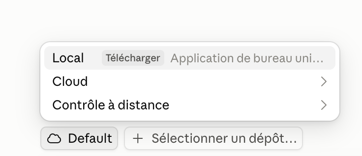
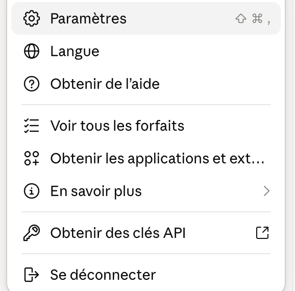
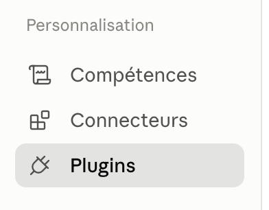

# Talking to the product in plain words

[Version française](guide-express.fr.md)

Ask questions about a product, create tickets, follow progress, by writing as
you would to a colleague. No need to know GitHub.

---

## The first time (once, 15 to 30 minutes)

1. Open the **Claude app**.
2. Click the **`</>`** icon at the top of the window (Claude Code).

   

3. Click **new chat**.
4. **Important: choose "Local".** By default, Claude works in the *cloud* (**Default** button, cloud icon): it cannot install anything on your computer. Click **Default**, then **Local**.

   

   If "Local" shows a **Download** button, you are in the browser: install and open the **Claude app** (https://claude.ai/download).
5. Click **Select a repository…**, then choose your **Documents** folder.
6. Copy the **setup message** ([click here to show it](getting-started.en.md#step-2-paste-the-setup-message)), paste it into the chat and send it.
7. Let Claude work. When it asks you:
   - click **Allow**;
   - type the code it gives you on the GitHub page that opens, then reply "done".
8. At the end, **fully quit the Claude app and reopen it**.
9. Check that the plugin is installed:
   1. Click **your name**, at the very bottom left of the window.
   2. Click **Settings**.

      

   3. In the left column, under **Customisation**, click **Plugins**.

      

   4. **product-desk** must be in the list. If not, see the [common problems](getting-started.en.md#common-problems).

---

## Every time

1. Open the **Claude app**.
2. Click **`</>`**.
3. Click **new chat**.
4. Choose **Local** (not "Default"), then click **Select a repository…**.
5. Choose the **Singulier** folder, then the **product** you are interested in.
6. Write your request, simply:
   - **a question**: "How is the price of a product calculated?"
   - **a ticket**: "Create a ticket: the export button does nothing on the clients page."
   - **a big subject**: "Create an epic for the export redesign." Claude splits it into several tickets grouped in an epic, with a diagram of the order they will be done in.
   - **progress**: "Where are we on the payment integration?"
   - **what you need to check**: "What do I need to test?", then "I tested #380, it works." Claude closes the ticket once you agree.
7. Claude shows you the ticket **before** creating it: read it, then reply "OK" or say what to change.
8. Shared a screenshot or a file? Claude asks which ones go in the ticket. You add images yourself on the ticket's GitHub page: Claude gives you the link, drag them into the comment box at the bottom.
9. Ticket created: type `/clear` or open a **new chat** for the next topic. A very long conversation makes Claude slower and less precise. Nothing is lost: it is all in the ticket.

---

**Lost?** Type `/product-desk:help` in the chat.

**Stuck?** Send a screenshot to the project admin.
